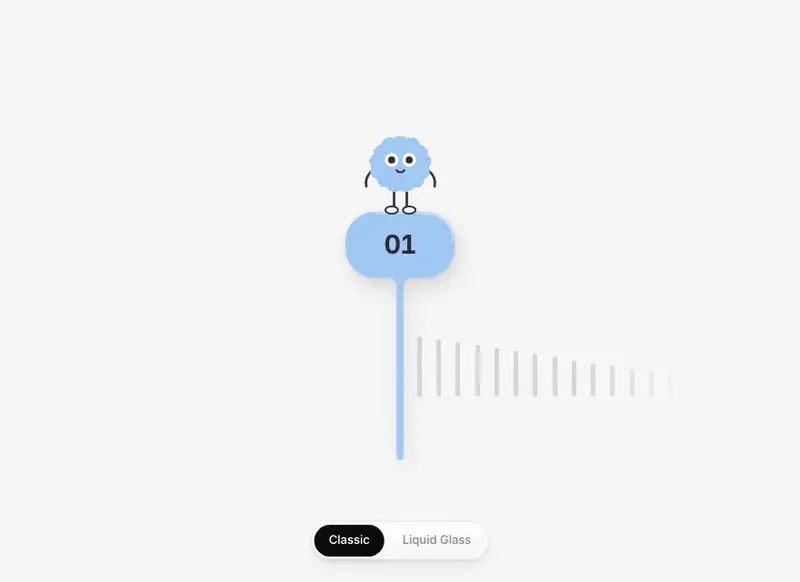

# Ruler Picker interaction

A draggable ruler under a fixed pin, with a fuzzy mascot riding on top. Drag or fling the ruler and it springs onto a whole tick while the digits roll into place. The mascot leans into the drag, hops on every tick, goes wide-eyed when you pull past the ends and cheers when it lands. Tap it to spin in the next fuzzy, and the pin takes its colour. A switch at the bottom moves between Classic and Liquid Glass.

<p align="center">
  
</p>

<p align="center"><a href="docs/demo.mp4">Watch as a video</a></p>

## Tech stack

- React 19
- Vite 8
- Tailwind CSS 4
- Pointer events with a hand-rolled spring in `requestAnimationFrame`, CSS transitions with a spring curve in `linear()`, no animation library
- Inline SVG mascots from the Agent Manager cast

## Run

```bash
npm install
npm run dev
```
